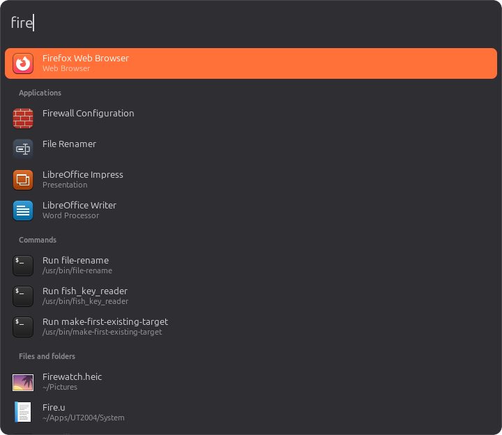

# mmk

[](https://github.com/arkady-emelyanov/mmk/actions/workflows/ci.yml)

Make Linux feel like macOS on an Apple keyboard, so switching between the two is seamless: your Mac shortcuts just work, in every app. A Spotlight-style search window comes with it: apps, commands, files and a calculator in one box, which turns into a terminal when you run something (see [Search](#search)).

## Supported desktops

| Desktop | Status |
|---|---|
| Cinnamon (Linux Mint), X11 | Tested, the default config targets it |
| MATE, Xfce, KDE Plasma, GNOME on X11 | Should work, untested. A few system shortcuts depend on the desktop's own bindings (`Cmd+Space` → `Super+Space`, `Cmd+Ctrl+F` → `Alt+F10`, `Cmd+Shift+3/4` → `Print`). GNOME needs the AppIndicator extension for the tray icon. |
| Any Wayland session | Remapping works, but per-app profiles don't yet: every app gets the global profile. |

mmk reads the keyboard below the display server (evdev/uinput), so remapping doesn't depend on the desktop. Only the per-app profiles (X11 window focus) and the tray icon (StatusNotifierItem) do.

## Install

Download the archive for your machine from the [latest release](https://github.com/arkady-emelyanov/mmk/releases/latest) and run its installer:

```
curl -L https://github.com/arkady-emelyanov/mmk/releases/latest/download/mmk-$(uname -m)-linux.tar.gz | tar -xz -C /tmp
/tmp/mmk install
```

The archive holds two programs: `mmk`, the remapper (a static binary that runs anywhere), and `mmk-search-ui`, the search window, which mmk starts and restarts on its own. The search window uses the system's GTK4 and VTE: install them if `mmk install` reports them missing (`sudo apt install libgtk-4-1 libvte-2.91-gtk4-0` on Debian, Ubuntu and Mint). The release builds need glibc 2.39 or newer (Linux Mint 22, Ubuntu 24.04, Debian 13); remapping works without the search window, and `mmk-<arch>-linux` alone is the remapper without search.

Builds are available for `x86_64` and `aarch64`; each file has a `.sha256` next to it. To build from source instead (the search window needs `libgtk-4-dev` and `libvte-2.91-gtk4-dev`):

```
cargo build --release --target x86_64-unknown-linux-musl -p mmk
cargo build --release -p mmk-search-ui
cp target/release/mmk-search-ui target/x86_64-unknown-linux-musl/release/
target/x86_64-unknown-linux-musl/release/mmk install
```

`mmk install` sets up permissions (one `pkexec` step, only if needed), copies both programs to `~/.local/bin`, checks that the search window can start, writes `~/.config/mmk/config.toml`, adds an autostart entry, warns about other running key remappers, and starts mmk. `mmk uninstall` reverses all of it, including the search index and history.

### Why the installer may ask for your password

mmk runs as your normal user, never as root. To work it needs two devices that a stock Linux system only lets root use:

| Device | Why mmk needs it | Default permissions |
|---|---|---|
| Your Apple keyboard, `/dev/input/eventN` | read its keys exclusively, so the original keystrokes don't also reach the desktop | root and the `input` group |
| `/dev/uinput` | create the virtual keyboard that mmk types the remapped keys through | root only |

If you can't open both, `mmk install` shows exactly what it is about to write and asks for your password once (through `pkexec`, or `sudo` if `pkexec` isn't available). It then, as root:

- writes `/etc/udev/rules.d/70-mmk.rules`, which gives the logged-in user access to `/dev/uinput` and to input devices with Apple's vendor IDs (`05ac`, `004c`) only. Other keyboards and mice stay off-limits, unlike adding yourself to the `input` group, which exposes every input device;
- writes `/etc/modules-load.d/mmk.conf` so the `uinput` kernel module loads at boot;
- loads the module and reloads the udev rules, so no re-login is needed.

That is the only privileged step. Running mmk, editing the config, updating and uninstalling all happen as your user; `mmk uninstall` asks for the password again only to delete those two files.

The step is skipped if you already have access. That happens, for example, when you're in the `input` group, or when another package's udev rules already grant `/dev/uinput`. `mmk doctor` shows which access is in place.

## Use

- Edit `~/.config/mmk/config.toml`; it reloads on save.
- `mmk doctor` checks permissions, keyboards, focus tracking and conflicts.
- `mmk focus` shows which profile the focused app gets.
- Tray icon: enable/disable, current profile, reload, open config, quit.
- Emergency exit: hold `Esc+Backspace+Enter`.
- Log: `~/.local/state/mmk/mmk.log`.

## Search



Press the hotkey and a search box appears centered on the screen; type, and results appear below it: apps (including executables and AppImages in `~/Apps` and `~/Applications`), commands on your `$PATH`, files and folders in your home, and calculator answers (`2^10`, `5 km to mi`, `0xff to decimal`). What you pick often ranks higher next time.

The hotkey is not bound by default. Add a rule for it, any trigger you like:

```toml
[keys]
"cmd-shift-space" = "search"
```

Without an Apple keyboard, or to use a desktop shortcut instead, bind the command `mmk search` in your desktop's keyboard settings.

| Key | Action |
|---|---|
| `Enter` | open the selected result; a command runs in the box's terminal |
| `Cmd+Enter` | show the file (or the app's `.desktop` file) in the file manager |
| `Shift+Enter` | run a command without a terminal |
| `Cmd+C` | copy the result: path, answer, command line |
| `Tab` | complete the entry to the selected result |
| `↑` / `↓`, `Cmd+↑` / `Cmd+↓` | move the selection / jump between groups |
| `Cmd+1` … `Cmd+9` | open the Nth result |
| `Esc` | close |

**Terminal in the box.** A query starting with `>` is a shell line (`> ls ~/Downloads | wc -l`), and `Enter` on a command runs it too: the box grows into a terminal running it. Inside it Cmd works as in other terminals (`Cmd+C` / `Cmd+V` copy and paste, `Cmd+=` / `Cmd+-` zoom), `Cmd+W` ends the session, and `Cmd+N` goes back to the search box while the session keeps running. When the program exits the window closes (`[search.terminal] on_exit = "search"` returns to the box instead).

**Cheat codes.** Typing a code opens the terminal at once, with no `Enter`:

- `@!` starts Claude Code. Its conversation is kept: the hotkey hides and shows the same session, and after it ends the next `@!` resumes that conversation (`claude --resume`). `Cmd+T` in it starts a fresh one.
- `@#` opens a shell.

Codes are config tables, so you can change these or add your own, with any program, folder and environment:

```toml
[search.codes.claude]
cwd = "~/Projects"         # where Claude Code starts (default ~)

[search.codes.top]
code  = "@%"
run   = "htop"
shell = false              # run it directly: the session ends when it exits
```

Claude Code uses its own login. To give it a dedicated token instead, run `claude setup-token` and save the token to `~/.config/mmk/claude-token` (mode 0600): mmk passes it to Claude Code only, as `CLAUDE_CODE_OAUTH_TOKEN`.

Everything else (size, theme, groups and their limits, which folders are indexed and which skipped, terminal font and size, keys) is under `[search]` in the config, with comments. The file index honors `.gitignore` files, so ignored files don't show up, and stays current as files change. Search never uses the network: only programs you start from it, like Claude Code, do.

If the search window can't run (not installed, or GTK4 missing), mmk keeps remapping, the tray says why, and the hotkey shows a notification instead.

## Typography

`Opt` types the same typographic characters as on a Mac (US layout), in every app:

| Shortcut | Character |
|---|---|
| `Opt+-` / `Opt+Shift+-` | – en dash / — em dash |
| `Opt+;` | … ellipsis |
| `Opt+[` / `Opt+Shift+[` | “ ” double quotes |
| `Opt+]` / `Opt+Shift+]` | ‘ ’ single quotes, apostrophe |
| `Opt+\` / `Opt+Shift+\` | « » guillemets |
| `Opt+Space` | non-breaking space |
| `Opt+8` / `Opt+Shift+9` / `Opt+Shift+8` | • bullet / · middle dot / ° degree |
| `Opt+6` / `Opt+7` / `Opt+T` | § section / ¶ paragraph / † dagger |
| `Opt+G` / `Opt+R` / `Opt+2` | © / ® / ™ |
| `Opt+Shift+2` / `Opt+3` / `Opt+4` / `Opt+Y` | € / £ / ¢ / ¥ |
| `Opt+=` / `Opt+Shift+=` | ≠ / ± |
| `Opt+,` / `Opt+.` | ≤ / ≥ |
| `Opt+/` / `Opt+X` / `Opt+5` | ÷ / ≈ / ∞ |
| `Opt+P` / `Opt+V` / `Opt+B` / `Opt+Z` / `Opt+M` | π / √ / ∫ / Ω / µ |

In terminals `Opt+.` stays `Alt+.` (readline: insert the last argument). These are ordinary `text:` rules in the config, so you can change them or add your own.

How it works: a virtual keyboard can only send key codes, so on X11 mmk borrows keycodes that have no meaning in your keymap (most keymaps have a dozen or two) and maps the characters onto them, two per keycode. Only the running X server's in-memory keymap changes, never a config file; mmk restores the mapping if the desktop resets the keymap, and clears it when it exits. If a config has more characters than free keycodes, the rest are mapped as they're typed. On Wayland mmk types them as `Ctrl+Shift+U`, the hex code, `Space`, which works in GTK apps and with IBus.

## Configure

The config lives in `~/.config/mmk/config.toml` and reloads on save; if it has an error, mmk keeps the previous config and logs why. `mmk check` validates it without running. The file written by `mmk install` (or `mmk init`) is the full default config with comments, so start from it: settings you leave out fall back to their defaults, but `[keys]` and `[[app]]` sections are not merged with the defaults. The file defines all rules and profiles.

Rules map a physical trigger to an action:

```toml
[keys]
"cmd-left"      = "home"                  # single chord, held while the key is held
"cmd-backspace" = "shift-home backspace"  # sequence of chords, tapped in order
"cmd-shift-k"   = "exec:notify-send hi"   # run a command on press
"opt-shift--"   = "text:—"                # type characters (see Typography)
"cmd-h"         = "none"                  # swallow the key
```

Triggers use the Mac modifiers `cmd`, `opt`, `ctrl`, `shift` and `fn`; actions use `ctrl`, `shift`, `alt` and `super`. Keys use evdev names (`a`, `1`, `f12`, `left`, `pageup`, `backspace`, `grave`, `leftbrace`, `comma`, `dot`, …). `Cmd+key` without a rule becomes `Ctrl+key` (the `cmd` setting).

App profiles override the global rules for matching windows. The first profile whose `class` matches wins:

```toml
[[app]]
name  = "terminal"
class = ["kitty", "org.gnome.terminal", "*ghostty*"]  # globs, case-insensitive
cmd   = "ctrl-shift"         # Cmd+key without a rule becomes Ctrl+Shift+key here
us_keys = true               # rule outputs like alt-b type their US character in any layout
[app.keys]
"opt-left" = "alt-b"

[[app]]
name  = "raw"
class = ["virt-manager"]
raw   = true                 # pass keys through untouched (VMs, remote desktops)
```

### Non-Latin layouts

A rule sends key positions, and the active layout decides what they type: with a Russian layout active, the terminal's `Opt+←` = `alt-b` arrives as `Alt+и`, which readline ignores. With `us_keys = true` (on for the default terminal profile; set it at the top for every app), letters, digits and punctuation in rule outputs type their US character whatever the layout, through a spare keycode as in Typography. Keys that type the same in all your layouts are sent as they are. Other apps don't need it: they match `Ctrl`/`Alt` shortcuts by key position. Works on X11 only.

### Finding an app's WM_CLASS

Focus the app while `mmk focus` is running. It prints each focused window's class and instance, and the profile it gets:

```
$ mmk focus
backend: x11  (Ctrl+C to stop)
app_id="kitty" instance="kitty" -> profile terminal
app_id="FreeCAD" instance="freecad" -> profile global
```

A `class` glob matches either value. Without mmk you can run `xprop WM_CLASS` and click the window; it prints `WM_CLASS(STRING) = "instance", "Class"`. Focus tracking works on X11 only, so on Wayland every app gets the global profile.

## Known limitations

- VS Code's integrated terminal: mmk can't tell it apart from the editor, and VS Code on Linux uses some keystrokes differently there. `Opt+Shift+←/→` resizes the terminal pane (it selects words in the editor), `Cmd+Backspace` doesn't delete to line start (use `Ctrl+U`), and copy/paste is `Cmd+Shift+C` / `Cmd+Shift+V`.
- `Opt+letter` and `Opt+digit` shortcuts that type a character (see Typography) no longer reach apps as `Alt+letter`/`Alt+digit`, so menu accelerators on those keys don't work with `Opt`. Delete the rule from the config to get `Alt` back for a key.
- `Cmd+click` is a plain click (Cmd is only translated together with a key); physical `Ctrl+click` works as usual.
- Focus tracking (per-app profiles) works on X11. On Wayland sessions every app gets the global profile for now.
- The search window is built and tested for X11. On Wayland it opens as a normal window, untested, and the compositor decides where.

## Develop

```
cargo test                                  # remapper: engine and config unit tests
cargo test -p mmk-search-ui                 # search: sources, ranking, index (needs the GTK4/VTE dev packages)
cargo run -p mmk-search-ui -- --query fire  # ranked results without a window
python3 tests/e2e.py                        # end-to-end through a fake Apple keyboard (needs /dev/uinput access)
```

The workspace has three crates: `mmk` (the remapper, `src/`), `crates/common` (key names, the `[search]` config and the protocol between the two programs) and `crates/search-ui` (the window).

The end-to-end test never touches the real keyboard or the desktop: it runs mmk against a fake uinput keyboard and grabs mmk's output device.
